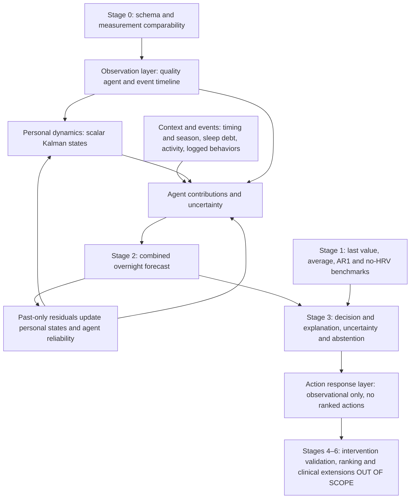

# Overnight forecasting engine

This is a Stage 2/3 demonstration on **SAMPLE data**, not a trained or validated physiological model. It implements the report's first milestone as a small, deterministic, client-side experiment. Nothing leaves the browser.



## Architecture

`assets/engine/index.js` exports `generateSampleNights`, `runCAS`, and `baselines`. No build or dependencies are required; the same ES modules run under Node and in the browser.

The shared environment retains dates, missingness, quality, device, metric, window and logged events. Six interacting agents represent observation quality, circadian/seasonal context, sleep duration and accumulated short nights, activity load, delayed behavior events, and personal dynamics. Each context contribution includes metric adjustments, an uncertainty multiplier and a reason key. The quality agent excludes poor or incompatible observations; gaps increase state uncertainty. Context uses only observations available before the target night. Bedtime/wake provide a coarse clock proxy, not measured circadian phase.

Each personal metric starts at a demonstration population prior: RMSSD 45 ms, RHR 58 bpm, sleep 450 minutes and activity 7,000 steps. These are **not clinical norms**. A scalar Kalman update assimilates observations after subtracting expected context contributions. State variance evolves online. Exponentially smoothed agent candidate errors produce inverse-error reliability weights, normalized to sum to one. Weights moderate context adjustments; the updated residual state feeds subsequent predictions. This is a simple hierarchical shared-prior/person-state approximation, not population training or a full multivariate state-space model.

Intervals combine state variance and fixed illustrative observation noise, widen for gaps and sparse data, and scale with square root of horizon. Means and intervals are clipped to broad demo bounds. The bands are nominal 95% illustrations, **not calibrated guarantees**. Sparse comparable nights, wide intervals relative to personal variability, or recent gaps with low confidence trigger abstention. No lifestyle actions are ranked even when confidence is higher.

## Inputs and outputs

`generateSampleNights({seed, count, endDate})` defaults to 42 nights ending 2026-10-31, fixing the date for reproducibility. It includes weekend timing/activity, a seasonal RHR component, sleep debt, delayed load, logged behaviors and missing/poor nights. Dates are UTC ISO calendar dates. Only overnight RMSSD from the sample PPG device is accepted; SDNN, paced-breathing windows and different devices are excluded rather than silently pooled. A future importer must implement explicit device comparability rather than reusing this sample gate.

`runCAS(nights, {horizon: 1, language: 'en', adapt: true, profile: {}})` expects unique chronological dates and returns four metric forecasts with means, bounds and units, confidence, abstention, localized observational explanations, backtest statistics, reliability weights and personal posterior parameters. Null measurements remain null. `adapt: false` freezes personal priors for an adaptation comparison. Longer horizons project context to the target date without assuming intervening observations; this preview focuses on one night.

## Baselines and evaluation

After 14 burn-in nights, each target is predicted before assimilation using its prefix only. Good comparable targets are scored separately for HRV and RHR. The public backtest `n` counts HRV targets; missing metric targets are omitted from that metric's denominator. Empty score sets return null, not zero error.

Comparators use the same quality gate: last available value, last up to seven good nights' average, bounded AR(1) on the demeaned past series, and a no-HRV alternative. AR(1) operates on the available observation sequence, so its lag can span calendar gaps. The no-HRV HRV forecast uses only sleep, activity and RHR summaries and a fixed prior; it never uses HRV history. CAS reports MAE and interval coverage; alternatives report MAE. The sample is deliberately generated with learnable personal levels and context, so winning here is an implementation check, not external evidence. High sample coverage can indicate overly broad bands.

Run `node --test` or `npm test`. Tests cover deterministic sampling, missingness, metric comparability, intervals, abstention, normalized weights, adaptation and baseline comparisons, and no-HRV independence.

## Limits

Sample forecasting demonstration with a vendor-neutral import preview; no vendor adapter, fitted population parameters, prospective evaluation or intervention validation. Context coefficients and noise are hand-set for this illustration. Age and height are optional illustrative prior covariates; consented health context stays separate from numerical forecasts. Events describe synthetic logged behaviors, not diagnoses. The model is observational, not causal; explanations do not establish that an event changed physiology. It does not measure sleep quality, stress, recovery, health or life expectancy, and is not medical advice. Stages 4–6, action ranking and clinical predictions remain out of scope.


## Factor registry

`assets/engine/factors/index.js` exports `FACTORS` in stable report order, `getFactor`, `evaluateFactor` and `assertSafeFactorOutput`. Each factor has its own module with EN/简体中文/Svenska evidence, limits, proposed use, inputs, citations, permitted output type, literature direction and source analysis method (`existingModel`). Evidence labels describe the cited designs, not a formal certainty assessment. Mixed designs use the primary label in the table; synthesis text retains conflicting and nonsignificant findings. The exported `EVIDENCE_STRENGTH_LABELS` maps `guideline`, `meta-rct`, `meta-obs`, `review`, `rct`, `observational`, `experimental`, and `adjacent` to Guide, Meta (RCT), Meta (obs), Review, RCT, Obs, Exp, and Adj. The badge shows the strongest relevant primary design; `evidenceDesigns` records all cited designs with localized detail. `literatureCell(factor,target)` maps only declared targets and uses `association.byTarget` before the default direction. Both card badges and matrix cells share these helpers. Reading is a single pragmatic RCT about self-reported sleep quality, with no HRV mapping.

| # | Factor | Role | modelRole | outputType | Citations |
|---|---|---|---|---|---|
| 1 | hrv | observation | observation | quality-gated-observation | [32] [35] |
| 2 | rhr | observation | observation | joint-trajectory | [3] |
| 3 | sleep | observation | observation | shortfall-forecast | [23] [21] |
| 4 | activity | observation | observation | load-context | [31] [36] |
| 5 | age | profile | nonlinear-covariate | descriptive-age-comparison | [8] |
| 6 | height | profile | candidate-covariate | candidate-covariate | [9] |
| 7 | education | profile | optional-covariate | optional-context | [4] |
| 8 | heartFailure | health | separate-pathway | evidence-only | [10] [11] [12] |
| 9 | mentalHealth | health | separate-pathway | evidence-only | [13] |
| 10 | lifeExpectancy | health | separate-pathway | evidence-only | [14] [15] |
| 11 | diet | behavior | logged-exposure | personal-association | [16] [17] [18] [19] |
| 12 | dailyHabits | behavior | logged-exposure | personal-association | [20] [22] |
| 13 | sport | behavior | logged-exposure | personal-association | [24] [25] [34] |
| 14 | work | behavior | logged-exposure | personal-association | [26] [27] [33] |
| 15 | reading | behavior | logged-exposure | personal-association | [5] |
| 16 | meditation | behavior | logged-exposure | personal-association | [6] [7] |
| 17 | timeOfDay | temporal | temporal-context | temporal-illustration | [1] |
| 18 | season | temporal | temporal-context | temporal-illustration | [2] [3] |

Citation numbers refer to the supplied *HRV Evidence and World Model Development Report*, 31 October 2026, references 1–39. Detail sheets retain these report citation IDs. Sleep and activity remain observation agents, not recommendation policies.

## Data schema and import/export

The import adapter previews Stage 1 harmonization; it is **not a real wearable importer for any specific vendor**. Version 1 JSON:

```json
{
  "version": 1,
  "measurements": [
    {"utc":"2026-10-01T22:00:00Z","timezone":"Europe/Stockholm",
     "device":"sample-ppg","metric":"RMSSD","unit":"ms","value":55,
     "window":"overnight","quality":"good","durationSeconds":28800}
  ],
  "events": [{"type":"reading","utc":"2026-10-01T20:00:00Z",
              "durationMinutes":20,"note":"paper book"}],
  "profile": {"age":40,"heightCm":170}
}
```

Measurements require utc (ISO timestamp with explicit UTC offset), IANA timezone, device, metric, unit, finite numeric value, window and quality. `durationSeconds` is optional and positive. Supported pairs: `RMSSD/ms`, `RHR/bpm`, `sleep/min`, `activity/steps`. Quality is `good`, `poor` or `missing`. Missing-quality values are never assimilated; the exporter uses a zero placeholder for an entirely missing sample night and the parser restores a null metric. This placeholder is not an observation. Raw imported measurement records, including duration, timezone and device, are retained. No firmware provenance is fabricated.

Measurement CSV header:

```csv
utc,timezone,device,metric,unit,value,window,quality,durationSeconds
```

CSV accepts quoted fields, escaped quotes and embedded newlines. A standalone events CSV has `type,utc,durationMinutes,note` (optional timezone); a combined CSV uses measurement columns plus `type,durationMinutes,note`, with measurement fields blank on event rows. Standalone events with no overnight measurements produce a validation error rather than replacing nights. `parseImport(text,{format:'json'|'csv'|'auto'})` returns `{ok,nights,events,errors,warnings}`. Optional JSON profile is reserved context and is not silently stored, especially not health information; enter profile information through the consent-aware form.

Measurements group by **local calendar date**, not host timezone or UTC day. Metrics on a date must share a device; duplicate metrics and incompatible devices on one date are errors rather than silently averaged. SDNN is rejected explicitly as incompatible with RMSSD. Non-overnight windows, including paced breathing, are excluded with warnings. Invalid fields, timestamps, timezones, units and numeric values produce errors. Events use an explicit event timezone or the unambiguous measurement timezone; ambiguous event timezones are reported and not merged. Devices retain their original names: only `sample-ppg` passes the current CAS/association comparability gate. This intentionally prevents arbitrary real-device data from becoming a falsely validated PPG model input.

`exportTimeline(nights,{format:'json'|'csv'})` exports measurement provenance and explicit events. JSON includes version 1; combined CSV preserves event rows. Sample exports remain labeled by filename and sample device. Imported-quality records remain inspectable even when excluded from forecasting. The imported badge describes the source, not clinical validation.

Local storage keys are `mond-factors-profile`, `mond-factors-logs` and `mond-factors-nights`. The store works in Node with an in-memory fallback. Browser changes dispatch `mond-data-change`. Logs are `{date:'YYYY-MM-DD',types:string[]}` and are merged by exact date without inventing exposures or mutating the source nights. Restoring samples clears imported nights only; deleting all factor data clears all three keys after confirmation. No MOND cloud is involved. Browser storage is not additional encryption.

## Personal associations and gating

`personalAssociation(nights,{exposure,metric:'hrvRmssdMs',lagNights:1,minN:5})` computes the difference of means on comparable good-quality overnight RMSSD sample-PPG nights, grouped by an **explicitly logged event on the prior calendar date**. Lag 0 is supported; missing dates never shift the lag. Outcomes must be finite. At least five observations are required in each group; otherwise counts and `not-enough-data` are returned. `associationsFromLogs` evaluates the nine supported log types. The synthetic generator stamps common exposures (alcohol/workout) and rare meditation, with small deterministic delayed patterns; these are **SAMPLE data, not research participants**.

The reported standard error is `sqrt(sWith²/nWith + sWithout²/nWithout)` using sample variances, with approximate normal 95% difference bounds `delta ± 1.96 se`. These are exploratory, unadjusted, within-person observational comparisons, not causal effects or calibrated inference: temporal autocorrelation, multiple comparisons, selection, overlapping exposures and confounding are not controlled. No such log is not confirmed abstention. A real analysis needs prospective logging and a suitable repeated-measures model. The literature matrix encodes published direction and design class with color, opacity and explicit glyphs; it never substitutes personal deltas for literature effects. A source-labeled detail chart shows personal comparisons separately.

The age curve is **illustrative, from 10-second ECG population data, not transferable to overnight PPG**. It is not a percentile or diagnosis. The optional latest overnight RMSSD point is a visual comparison across incompatible contexts, not normalization. CAS applies only a mild nonlinear age offset to the demonstration HRV prior (ages 18–90), not a fitted age reference. Height contributes a small candidate inverse RHR prior offset using adjacent HR evidence. Neither is calibrated. Education never changes forecasts, and explanation detail is a separate preference. The hand-set logged-event coefficients are modest delayed demonstration associations, never action rankings. All health context remains outside forecast computations.

## Safety boundaries

Heart failure, mental health and life expectancy are three **separate clinical/research pathways**, each restricted to `evidence-only`. `evaluateFactor` calls the recursive `assertSafeFactorOutput` guard; clinical payloads cannot contain riskScore, diagnosis, yearsOfLife, lifeExpectancyYears, survivalProbability, hazard or clinicalRisk (including nested variants). They expose evidence, limits and citations without a personal risk chart. Forbidden output metadata additionally records individual-risk-score, diagnosis and years-of-life; life expectancy also forbids life-expectancy-prediction. Mortality association is never relabeled remaining lifespan. MAGGIC is not a consumer HRV score. HRV is not a psychiatric classifier.

Known conditions, medication and an independently assessed wellbeing score require explicit on-device storage consent; each supports prefer-not-to-say. Revoking consent removes health data when the profile is saved. These fields are context labels only and do not enter numerical forecasts. MOND never computes wellbeing from HRV. It never infers meals, alcohol, work stress, medication or any unlogged behavior from deviations. No mixing RMSSD with SDNN, paced breathing with overnight/resting, or incompatible devices. Copy is observational; sample data stays labeled; this is not medical advice.

## Roadmap scope

This milestone adds Stage 0 factor/output contracts and schema, a Stage 1 **import preview**, and Stage 2/3 **sample-data** context, personal adaptation and exploratory associations. It does not establish external validity by importing an export. Stage 4 action-effect identification, Stage 5 action ranking and Stage 6 clinical extensions remain out of scope. Heart failure, independently assessed mental-health outcomes and survival analysis each require their own Stage 6 protocol, datasets, clinical variables, validation and intended claims. No risk scores, diagnoses, years-of-life predictions or lifestyle action ranking are implemented.

The emotion compass is a three-level check-in transcribed from a printed wheel, with vocabulary kept in `assets/engine/emotionWheel.js`. Check-ins are saved locally through `store.js`, with optional intensity and note, and 7/30-local-day core distributions. An unadjusted, non-diagnostic exploratory view compares sample HRV/sleep (or imported nights), joining nights starting on the check-in date. Only good-quality overnight RMSSD nights from one device and days with check-ins are compared, with at least five nights per group; multiple check-ins do not duplicate nights. It is not causal, a clinical scale, or a mood/recovery score. No MOND cloud is used.

Feelings can be logged without a sensor via `#feel`, while session “save this moment” still requires a live sensor or sample session.

Saving a live sensor or sample moment opens an optional feeling overlay linked to that session; skip keeps the moment without a feeling.

The optional first-aid corner, **情绪急救角 / Safe Space Within** (`#safe-space`), digitizes the workbook as redrawn SVG clouds, a whale-to-bubbles size scale, texture choices, and before/after distress drops; no workbook photo is embedded. It is always accessible from the journal. Both feeling-save flows offer an invitation after a negative core (fear, anger, disgust, sadness, low) reaches intensity 4; joy and surprise do not trigger it. `assets/engine/firstAid.js` holds the single configurable threshold and future per-node strategy map. Exercises save locally under `mond-factors-first-aid`, optionally linked to the triggering emotion, and clear with all factor data. This reflection is not a substitute for professional help or a diagnosis. Locale-specific support copy uses China’s medical emergency 120 ([MIIT/Beijing CA number list](https://bjca.miit.gov.cn/zwgk/tzgg/art/2022/art_8d4eb93ee3424f30826c97ee400e8937.html)) and national mental-health aid line 12356 ([NHC notice 国卫医政函〔2024〕259号](https://www.gov.cn/zhengce/zhengceku/202412/content_6994470.htm)); Swedish copy uses emergency 112, healthcare advice 1177 ([Krisinformation](https://www.krisinformation.se/en/finding-help-and-services/important-phone-numbers/)) and Mind Självmordslinjen 90101 ([Mind](https://mind.se/stod-kunskap/prata-eller-chatta-med-volontar/sjalvmordslinjen/)). English copy refers to local emergency services or a crisis line without assuming a country.

FOREST’s tree exercise and 4-4-4-4 box breathing are digitized from the verified workbook transcription, with redrawn SVG illustrations rather than workbook photos. Invitations resolve emotion ancestors: anger, fear, disgust, and 侵略性 (aggressive) descendants at any or missing intensity offer FOREST first with Safe Space as a choice; sadness/low at integer intensity ≥4 offer Safe Space first with FOREST as a choice. FOREST leaves and optional reflections are saved locally in the shared first-aid store, linked to the triggering emotion when available, and grow on a tree with individual deletion. Box breathing has no emotion mapping and is reachable from the strategy list.

The FOREST garden now offers three softly illustrated SVG tree variants (willow by default), branch buds that bloom as steps finish, and saved leaves at stable branch tips. Reflection layouts leave room for mobile navigation and scrollable dialogs; selection taps update previews in place and feelings charts reuse unchanged data. Optional, editable suggestion chips accompany free-text reflections and session notes, using local bilingual, emotion-aware, non-clinical phrases; no remote service is involved.
