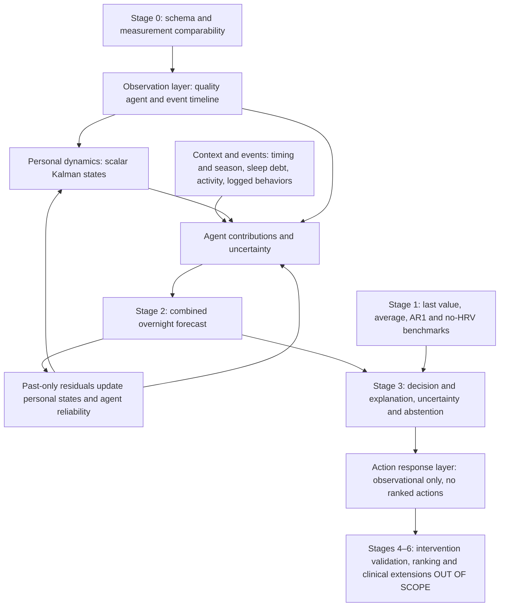

# Overnight forecasting engine

This is a Stage 2/3 demonstration on **SAMPLE data**, not a trained or validated physiological model. It implements the report's first milestone as a small, deterministic, client-side experiment. Nothing leaves the browser.

## Architecture

`assets/engine/index.js` exports `generateSampleNights`, `runCAS`, and `baselines`. No build or dependencies are required; the same ES modules run under Node and in the browser.

The shared environment retains dates, missingness, quality, device, metric, window and logged events. Six interacting agents represent observation quality, circadian/seasonal context, sleep duration and accumulated short nights, activity load, delayed behavior events, and personal dynamics. Each context contribution includes metric adjustments, an uncertainty multiplier and a reason key. The quality agent excludes poor or incompatible observations; gaps increase state uncertainty. Context uses only observations available before the target night. Bedtime/wake provide a coarse clock proxy, not measured circadian phase.

Each personal metric starts at a demonstration population prior: RMSSD 45 ms, RHR 58 bpm, sleep 450 minutes and activity 7,000 steps. These are **not clinical norms**. A scalar Kalman update assimilates observations after subtracting expected context contributions. State variance evolves online. Exponentially smoothed agent candidate errors produce inverse-error reliability weights, normalized to sum to one. Weights moderate context adjustments; the updated residual state feeds subsequent predictions. This is a simple hierarchical shared-prior/person-state approximation, not population training or a full multivariate state-space model.

Intervals combine state variance and fixed illustrative observation noise, widen for gaps and sparse data, and scale with square root of horizon. Means and intervals are clipped to broad demo bounds. The bands are nominal 95% illustrations, **not calibrated guarantees**. Sparse comparable nights, wide intervals relative to personal variability, or recent gaps with low confidence trigger abstention. No lifestyle actions are ranked even when confidence is higher.

## Inputs and outputs

`generateSampleNights({seed, count, endDate})` defaults to 42 nights ending 2026-10-31, fixing the date for reproducibility. It includes weekend timing/activity, a seasonal RHR component, sleep debt, delayed load, logged behaviors and missing/poor nights. Dates are UTC ISO calendar dates. Only overnight RMSSD from the sample PPG device is accepted; SDNN, paced-breathing windows and different devices are excluded rather than silently pooled. A future importer must implement explicit device comparability rather than reusing this sample gate.

`runCAS(nights, {horizon: 1, language: 'en', adapt: true})` expects unique chronological dates and returns four metric forecasts with means, bounds and units, confidence, abstention, localized observational explanations, backtest statistics, reliability weights and personal posterior parameters. Null measurements remain null. `adapt: false` freezes personal priors for an adaptation comparison. Longer horizons project context to the target date without assuming intervening observations; this preview focuses on one night.

## Baselines and evaluation

After 14 burn-in nights, each target is predicted before assimilation using its prefix only. Good comparable targets are scored separately for HRV and RHR. The public backtest `n` counts HRV targets; missing metric targets are omitted from that metric's denominator. Empty score sets return null, not zero error.

Comparators use the same quality gate: last available value, last up to seven good nights' average, bounded AR(1) on the demeaned past series, and a no-HRV alternative. AR(1) operates on the available observation sequence, so its lag can span calendar gaps. The no-HRV HRV forecast uses only sleep, activity and RHR summaries and a fixed prior; it never uses HRV history. CAS reports MAE and interval coverage; alternatives report MAE. The sample is deliberately generated with learnable personal levels and context, so winning here is an implementation check, not external evidence. High sample coverage can indicate overly broad bands.

Run `node --test` or `npm test`. Tests cover deterministic sampling, missingness, metric comparability, intervals, abstention, normalized weights, adaptation and baseline comparisons, and no-HRV independence.

## Limits

Sample data only; no real-data importer, fitted population parameters, prospective evaluation or intervention validation. Context coefficients and noise are hand-set for this illustration. No age or medical history is collected. Events describe synthetic logged behaviors, not diagnoses. The model is observational, not causal; explanations do not establish that an event changed physiology. It does not measure sleep quality, stress, recovery, health or life expectancy, and is not medical advice. Stages 4–6, action ranking and clinical predictions remain out of scope.
